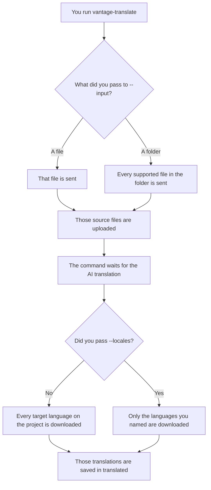
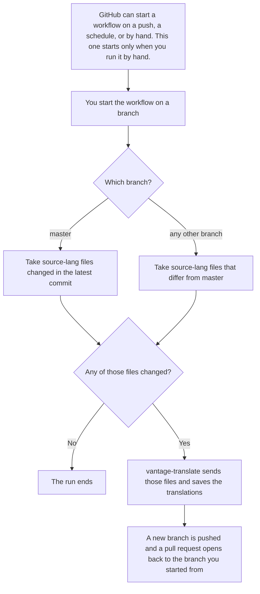

# Translate files with Vantage

Send one or more files to a Lokalise Vantage project and save the translations on your machine.

You need Python 3.11 or newer, a read/write Lokalise API token, and the UUID of a Vantage file project. In Lokalise, open your avatar, then Profile settings, then API tokens, and create a read/write token.

Put your token and project UUID in `.env` in this folder. That file stays on your machine. The command finds it from this folder or from a subfolder such as `source-lang`.

```powershell
py -3 -m pip install -e .
py -3 -m vantage_client --input source-lang --output translated
```

The `.` on the install line is the current folder. Leave it in.

`--input` can be a file or a folder. Repeat it to send more than one path. A folder is searched for DOCX, PPTX, XLSX, HTML, Markdown, and IDML files. Each file must be 50 MB or smaller.

The command uploads the files you name, waits for the AI translation, and writes the results to `translated`. If the project also uses human review, it downloads the AI files once they are ready and does not wait for reviewers. A file named `guide.docx` comes back as `guide.de-DE.docx` for German, and the same pattern for each other downloaded language. Only the files from this run are downloaded.

`--locales` chooses which target languages are downloaded. The upload is the same either way: the source files go to the project, and Vantage translates them into the project’s target languages. Without `--locales`, the download includes every target language on the project. Pass a comma-separated list to download a subset:

```powershell
py -3 -m vantage_client --input source-lang\getting-started.md --locales de-DE,fr --output translated
```

That command uploads `getting-started.md` and downloads the German and French files. The default wait for each step is 30 minutes.

## On your machine

The command reads `.env`, sends only the files you name, and writes the translations to `translated`.



## GitHub Action

Start the **Translate with Vantage** workflow by hand, on the branch that holds the source files. The workflow uses `vantage-translate` for the upload and download, then opens a pull request with the results. Each run gets its own pull request.



The Lokalise token is the repository secret `VANTAGE_API_TOKEN`. The project id is the repository variable `VANTAGE_PROJECT_ID`.
